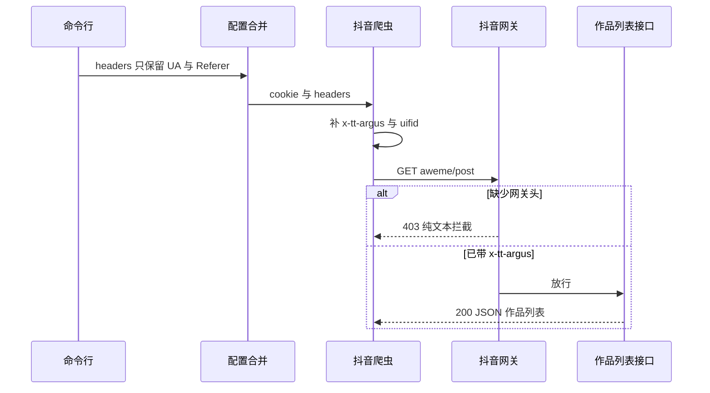

# 抖音作品列表 403（Argus 网关）修复记录

- 日期：2026-10-11
- 分支：`jxz-v0.0.1.8-pw3`（从本地 `v0.0.1.8-pw3` 的 `5f01ae1` 拉出）
- 现象：`f2 dy` 能拿到用户资料，作品列表接口返回 HTTP 403，日志显示「第 0 页没有找到作品」
- 结论：cookie 仍然有效。抖音边缘网关 `ArgusSecurityPlugin` 要求请求头 `x-tt-argus`（以及建议同时带 `uifid`）。当前树未包含上游 `9b759fc`，已按该提交的行为手工合入。
- 结果：补齐请求头后，作品列表接口返回 200；用户确认批量下载成功。

## 背景

F2 用网页端接口拉抖音主页作品，关键地址是：

- 用户资料：`https://www.douyin.com/aweme/v1/web/user/profile/other/`
- 作品列表：`https://www.douyin.com/aweme/v1/web/aweme/post/`

请求本来就会带登录 cookie、`User-Agent`、`Referer`，并用 `a_bogus` 做查询参数签名。2026 年 8 月起，抖音在边缘网关（响应头 `Server: TLB`）挂了 `ArgusSecurityPlugin`。缺少网关要求的请求头时，**cookie 再完整也会 403**。

社区时间线（见 [issue #443](https://github.com/Johnserf-Seed/f2/issues/443)、[PR #446](https://github.com/Johnserf-Seed/f2/pull/446)）：

| 大约时间 | 被拦接口 |
| --- | --- |
| 2026-08 中旬 | 喜欢、收藏、收藏夹等登录态列表 |
| 2026-09-10 左右 | 合集作品 |
| 2026-09-14 左右 | 主页作品 `aweme/post`、单作品 `aweme/detail` |

本仓库上游开发分支 `v0.0.1.8-pw3` 已在 2026-09-25 合入 `9b759fc`（修复说明里写明移植自 #446）。本地当时仍停在 2026-09-12 的 `5f01ae1`，**没有这笔提交**。

## 现象与复现

### 第一次（2026-09-15 / 09-16）

工作目录：`<<PATH>>/data/programs/ubuntu_venv/f2<</PATH>>`

配置：`<<PATH>>/data/programs/ubuntu_venv/f2/conf/mei_da_bao.yaml<</PATH>>`

日志模式稳定为：

1. 用户资料接口 200
2. 作品列表接口 403
3. 报「未知 HTTP 状态码错误：403」
4. 再报「第 0 页没有找到作品」，进程以 0 退出

当时 cookie 键数量足够（约 60+），含 `sessionid`、`ttwid`、`s_v_web_id`、`UIFID`。说明不是「cookie 过短 / 未登录」。9 月 16 日从可写目录用同一份配置跑过一次，作品列表也曾短暂返回 200 并开始下载，说明早期拦截有时会放行。

### 第二次（2026-10-11，可稳定复现）

在宿主机上：

```sh
cd /data/programs/ubuntu_venv/f2
source ../bin/activate
f2 dy -i all -c conf/xiao_shu_lin.yaml --auto-cookie chrome
f2 dy -i all -c conf/xiao_shu_lin.yaml
```

注意：`--auto-cookie` 会询问是否写回配置文件。非交互环境需要自动回答 `Y`。Chrome 当时在运行，cookie 仍写入成功。

配置：`<<PATH>>/data/programs/ubuntu_venv/f2/conf/xiao_shu_lin.yaml<</PATH>>`

cookie 约 69 项，含 `sessionid`、`UIFID`、`ttwid`、`sid_guard` 等。更新 cookie **之后仍然 403**。

实际发出的请求头只有 `Cookie`、`User-Agent`、`Referer`，没有 `uifid`、没有 `x-tt-argus`。

作品列表 403 的响应：

- `content-type: text/plain`
- `content-length: 46`
- 正文：`Blocked by ArgusSecurityPlugin Uifid Not Found`

用户资料接口在同一轮请求里仍是 200。因此问题不在登录态本身，而在作品列表网关校验。

## 根因

### 网关在查请求头，不是查 cookie 是否过期

对照实验（同一份 cookie，只改请求头）：

| 请求头 | 作品列表结果 | 响应正文前缀 |
| --- | --- | --- |
| 现状：`Cookie` + `User-Agent` + `Referer` | 403 | `Blocked by ArgusSecurityPlugin Uifid Not Found` |
| 只加 `uifid`（从 cookie 的 `UIFID` 取出） | 403 | `Blocked by ArgusSecurityPlugin Signature Not Found` |
| 只加 `x-tt-argus: 1` | **200** | `{"status_code":0,... "aweme_l` |
| `uifid` + `x-tt-argus: 1` | **200** | 同上 |

当前网关：

1. 没有 `uifid` 时，报 `Uifid Not Found`
2. 有 `uifid` 但没有 `x-tt-argus` 时，报 `Signature Not Found`
3. **真正放行作品列表的，是 `x-tt-argus` 这个头在不在**；取值目前只校验存在，占位 `1` 即可
4. 浏览器还会发 `uifid`，值来自 cookie 的 `UIFID`（未登录时是 `UIFID_TEMP`）。应一并带上，与浏览器一致

`--auto-cookie` 解决不了这件事：它只更新 cookie 字符串，不会补网关请求头。

### 为什么日志看起来像「没有作品」

`handle_http_status_error` 没有单独处理 403，当成未知状态码抛错，**不会按 `max_retries` 重试**。

`_fetch_get_json` 把异常吃掉后返回空字典 `{}`。上层 `fetch_user_post_videos` 看到没有作品，就打印「第 0 页没有找到作品」并以成功结束。这次修复**没有改**这两处行为。

### 配置里的自定义 headers 为什么没发出去

CLI 会先把 `User-Agent` / `Referer` 写进 `kwargs["headers"]`，再走 `merge_config`。CLI 参数整表覆盖自定义配置的 `headers`，yaml 里其它头会被丢掉。

网关头改在 `DouyinCrawler` 构造时从 cookie 自动补，不依赖 yaml 手写 `uifid` / `x-tt-argus`。



## 为什么不直接 cherry-pick 上游

本地 `v0.0.1.8-pw3` 停在 `5f01ae1`，仓库里没有 `9b759fc` 对象，无法直接 cherry-pick。

即便把该提交补进来，也合不干净：

- `9b759fc` 依赖 `parse_cookie_str()`，当时本地 `cookie.py` 没有这个函数
- 上游同名分支在 9 月 12 日之后还有其它改动（例如 crawler 的代理 URL 处理）。整支 merge / rebase 会把无关变更带进当前分支

因此按 **9b759fc 的行为手工合入当前树**，不拉整支上游。

上游提交摘要：

> fix: 抖音请求自动附加网关要求的 x-tt-argus 与 uifid 请求头，修复 403 (#443)

维护者说明：网关目前只校验 `x-tt-argus` 是否存在，游客 cookie 也要带；有 `UIFID` / `UIFID_TEMP` 时再发 `uifid`。已配置的同名头优先，比较时不区分大小写。

## 修改细节

未改 `DouyinWebSocketCrawler`（上游这笔也没动它）。

### 1. 解析 cookie 字符串

文件：`<<PATH>>/data/code/github/f2/f2/utils/http/cookie.py<</PATH>>`

新增 `parse_cookie_str`：

- 按 `;` 分段
- 只在第一个 `=` 切开，值里的 `=` 保留
- 忽略没有名字或没有 `=` 的片段
- 同名 cookie 以后一次为准

用于从 cookie 取出 `UIFID` / `UIFID_TEMP`，不把整段 cookie 打进日志。

### 2. 网关请求头管理

文件：`<<PATH>>/data/code/github/f2/f2/apps/douyin/utils.py<</PATH>>`

新增 `GatewayHeaderManager`：

- `ARGUS_PLACEHOLDER = "1"`
- `gen_gateway_headers(cookie)`：始终返回 `x-tt-argus`；cookie 有 `UIFID` 或 `UIFID_TEMP` 时再加 `uifid`（优先 `UIFID`）
- `merge_headers(headers, cookie)`：已配置同名头（大小写不敏感）不覆盖；网关头插到已有头前面

`x-tt-argus: 1` 是权宜之计。若网关开始校验签名值，可在 `conf.yaml` 的 `douyin.headers` 里填浏览器真实值覆盖占位。更稳的做法是让真实页面里的 SDK 自己发请求，而不是逆向签名。

### 3. 爬虫构造时合并

文件：`<<PATH>>/data/code/github/f2/f2/apps/douyin/crawler.py<</PATH>>`

`DouyinCrawler.__init__` 由：

```python
self.headers = kwargs.get("headers", {}) | {"Cookie": kwargs.get("cookie")}
```

改为：

```python
cookie = kwargs.get("cookie")
self.headers: Any = GatewayHeaderManager.merge_headers(
    kwargs.get("headers", {}), cookie
) | {"Cookie": cookie}
```

所有走 `DouyinCrawler` 的 HTTP 接口（主页作品、单作品、点赞、收藏等）都会带上网关头。

### 4. 测试

- `<<PATH>>/data/code/github/f2/tests/test_cookie.py<</PATH>>`：解析、保留值内 `=`、忽略空段、同名后者覆盖、非字符串报错
- `<<PATH>>/data/code/github/f2/f2/apps/douyin/test/test_douyin_gateway_headers.py<</PATH>>`：占位 `x-tt-argus`、提取 `UIFID`、回退 `UIFID_TEMP`、显式头大小写不敏感优先、爬虫构造后请求头齐全

`black` / `isort` / `mypy` 已过。上述 11 个单测全部通过。这些测试不访问网络。

### 5. 变更说明

`CHANGELOG.md` Unreleased 增加：修复抖音作品列表等接口被 Argus 网关返回 403 的问题。

## 验证

虚拟环境 `<<PATH>>/data/programs/ubuntu_venv<</PATH>>` 里的 `f2` 已是开发安装，指向 `<<PATH>>/data/code/github/f2/f2/__init__.py<</PATH>>`。改源码即生效，不必再 `pip install -e .`。

合入后用 `xiao_shu_lin.yaml` 打作品列表：

- 请求头含 `uifid`、`x-tt-argus`
- HTTP **200**
- JSON：`status_code: 0`，`has_more: 1`

用户随后批量下载成功。

## 影响范围

GitNexus：改 `DouyinCrawler.__init__` 为 LOW；整个 `DouyinCrawler` 类为 MEDIUM（`handler` 与文档示例会实例化它）。公开方法签名未变，只在构造时多合并两个请求头。

## 未做、以及以后可能再坏的地方

1. **没有**逆向或实现 `x-secsdk-web-signature`。当前网关不校验 `x-tt-argus` 的取值；一旦真验签名，占位 `1` 会再变成 `Signature Not Found`。
2. CLI `merge_config` 仍会整表覆盖 yaml 的 `headers`。网关头现在从 cookie 自动补，一般够用；若要让 yaml 里的其它自定义头生效，需要另改合并逻辑。
3. 403 仍不会按 `max_retries` 重试，仍可能被吞成「没有作品」。网关头生效后主路径不再踩这个坑，但其它 403 场景日志仍会误导。
4. 未改 WebSocket 直播爬虫的请求头。

## 参考

- [f2#443 抖音 Client error 403 Forbidden](https://github.com/Johnserf-Seed/f2/issues/443)
- [f2#446 为列表接口补网关请求头](https://github.com/Johnserf-Seed/f2/pull/446)
- 上游提交 `9b759fc`：`fix: 抖音请求自动附加网关要求的 x-tt-argus 与 uifid 请求头，修复 403 (#443)`
